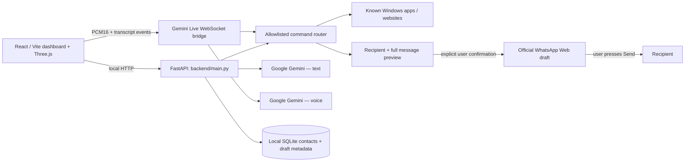

# Phase 1 — actual repository assessment and implementation plan

Historical 0.7 review: the continuous-voice lifecycle and Exit changes in 0.8 are documented in [continuous-voice-0.8.md](continuous-voice-0.8.md). Its new implementation order prioritizes continuous conversation and resource cleanup before the remaining onboarding, scheduling and distribution work.

12 November 2026. This review covers the existing INDU workspace, including the 3D/interface work already in progress when the expanded specification arrived. It does not claim the later phases are complete.

Update for 0.7.1: following the user's clarification, active text chat now uses Gemini as well as voice. Ollama is no longer required or queried. The frontend detects the earlier 0.6.1 backend and requests a restart before using absent routes. The remaining secure-onboarding and later-phase work below is unchanged.

## Assessment

Keep the current React/Vite frontend and FastAPI backend. They provide a useful local foundation, and there is no reason to create another application or competing server. The current project is a source-run prototype, not an installable product.

Typed knowledge questions now go to **Gemini text generation**, while browser voice goes to **Gemini Live**. The main remaining setup gap is first-launch key onboarding and OS credential-store integration. There is also no local reminder scheduler, live-data provider layer, desktop wrapper, or installer.

The source folder is not a Git repository. The initial code audit and source backup are under `reports/`. The backup may contain private historical configuration and must never become distribution input.

### Existing implementation and gaps

| Area | Current implementation | Gap against the specification |
| --- | --- | --- |
| Backend | One FastAPI app; local HTTP APIs; a Gemini WebSocket bridge; lazy STT loading. | Per-launch API authentication and installable lifecycle still needed. |
| Text intelligence | `brain/llm.py` calls Gemini and keeps bounded in-memory history; text and voice share persona instructions. | Session isolation, user voice preferences, and grounded current-information routing. |
| Gemini configuration | Backend environment variable; optional SDK import; configuration accepted by installed SDK. | Key validation request, welcome UI, keyring, replace/disconnect settings. No authenticated connection was tested. |
| Voice | Wake recognition, manual activation, 16 kHz input, 24 kHz output, VAD configuration, interruption events, scheduled playback, cancellation cleanup. | Actual multilingual audio/quality tests, selectable devices, preferences, and dedicated stop-speaking controls. |
| Desktop control | Exact known websites and fixed Windows executables/settings; no model-generated shell commands. | Registry/shortcut discovery, Office applications, user folders, Bluetooth/Wi-Fi settings, explicit permission policies. |
| WhatsApp | Local contacts/aliases, complete-message preview, explicit confirmation, official Web linking and prepared drafts. | Verified account state, reliable direct sending, and delivery receipts are unavailable. User-controlled final sending is the active fallback. |
| Contacts/database | SQLite is now used for contacts, aliases, and minimal draft metadata. | OS application-data migration and a backup/export policy for distribution. |
| Reminders | No scheduler or reminder data model. | Parsing, persistence, recurrence, notifications, snooze, restart recovery, time zones. |
| Real-time facts | No provider layer. | BTC/ETH prices, weather, news and current-information provenance. |
| Interface | Existing React entry point now renders a WebGL 3D core, text/voice controls, conversation, connection cards and contact/preview dialog. | Onboarding, settings, reminders and several detailed assistant states belong to later phases. |
| Distribution | Run Python and Vite manually. | Bundled backend, desktop lifecycle, signed installer/uninstaller and clean-machine testing. |

### Duplicated or unfinished code

- `frontend/src/App.jsx` is the earlier unused voice interface. The active entry point is `main.jsx` → `InduApp.jsx` → `DesktopDashboard.jsx`.
- `frontend/src/components/InduCore.*` is an unused visual alternative; its CSS also contains repeated definitions. It is not loaded by the active dashboard.
- `backend/tools/browser.py` is a separate, unused Playwright controller. The active router launches the system browser.
- `backend/brain/memory.py`, `planner.py`, and `backend/tools/computer.py`, `files.py` remain empty placeholders. They are not presented as working features.
- Manual microphone demos remain useful diagnostics, but are not substitutes for hardware or multilingual accuracy tests.
- Several old virtual environments exist. Only `backend/venv` was used for this audit. They must not be bundled into an installer.

## Security findings and first-phase improvements

| Priority | Finding | Result |
| --- | --- | --- |
| High | An automatic personal-account sending implementation was not verified against a real account and conflicted with the new confirmation requirement. | Automatic transmission removed from the active workflow. Preparation returns a preview; a separate confirmation opens an official WhatsApp Web draft. The user presses Send there. |
| High | A partial voice command or repeated request could cause a premature/duplicate action. | Complete input is required; local results end the turn; random preview IDs expire; cancelled IDs cannot continue; persistent request IDs prevent repeated draft opening. |
| High | Developer contact data was embedded in source. | Removed from source defaults. Existing local contacts are preserved in SQLite. Tests use synthetic contacts and isolated databases. |
| High | A durable outbox could unnecessarily retain private message bodies. | Persist only a message fingerprint and status metadata. Full pending previews stay in memory, can be cancelled, expire for confirmation after 10 minutes, and clear on backend shutdown. The draft URL itself is handled by the user's browser. |
| High | Browser origins could invoke local operations. | Existing HTTP/WebSocket origin restrictions retained; confirmation routes are covered by the same rejection and regression tests. This is not a substitute for per-launch authentication. |
| High, open | Keys are still configured through the backend environment, not Windows Credential Manager/keyring. | Phase 2 blocker for distribution. No browser key storage or key-entry placeholder was introduced. |
| High, open | Local HTTP API has no per-launch authentication token. | Keep bound to loopback. Add authenticated local IPC/HTTP and host validation before packaging or broader access. |
| Medium | Same contact/alias could resolve ambiguously. | New collisions are rejected; ambiguous legacy records request a distinct name rather than selecting the first match. |
| Medium | New React components needed automatic JSX compilation. | Added the existing React Vite plugin configuration; browser runtime verified afterward. |
| Medium | A configured Gemini key could be mistaken for a verified service connection. | Dashboard says "Configured" for configuration-only readiness. Live validation remains Phase 2. |
| Medium | Development dependencies and generated data could be packaged accidentally. | Database/session patterns are ignored; packaging plan requires a positive allowlist, not simply copying this workspace. |
| Medium, open | Local database is ordinary SQLite, not encrypted storage. | Keep it local and excluded from source/distribution. Define OS storage/permissions in Phase 2. Message fingerprints are not encryption. |
| Low | Existing chat prompt assumed a developer-specific user name. | Removed that assumption. Persona and fictional birth date will be configured consistently in Phase 3. |

The personal-account fallback follows the official [WhatsApp linked-device workflow](https://faq.whatsapp.com/378279804439436/). Opening a Web page is not evidence that a phone was linked. Opening a draft is not evidence that a message was sent or delivered. The app reports these limits explicitly.

## Phased implementation plan and exit criteria

Each phase should finish with a modified-file summary, relevant automated tests, manual/service checks where required, and an explicit limitations report.

| Phase | Implementation | Required exit evidence |
| --- | --- | --- |
| **1 — inspection/security** | Map current entry points and data flow, preserve working features, close immediate command/confirmation/privacy problems, verify the current dashboard, document gaps. | Passing offline suites and browser checks; no silent message transmission; this assessment and roadmap. |
| **2 — secure Gemini setup** | Add welcome/onboarding and settings. Validate the user's key through the local backend using a supported Gemini model. Store it with Windows Credential Manager via keyring; return status only. Move app configuration into OS app-data locations. Add local per-launch API authentication. | Successful and failed key validation; replace/disconnect; restart reuses key; no keys in browser storage, logs, source or distributions; missing/locked keyring behavior tested. |
| **3 — intelligence/voice** | Refine the shared Gemini text/live integration with per-session context, fictional persona/DOB, multilingual behavior, device selectors, interruption and stop-speaking controls. | Live text/voice tests with credentials; English/Telugu/Hindi audio samples; device changes, interruption, no overlapping streams, complete playback and wake return. |
| **4 — desktop control** | Add a Windows adapter using registered app paths/shortcuts/known folders and fixed URI handlers. Include Office/apps/folders/settings through structured allowlisted actions. Keep a platform adapter interface for later macOS/Linux. | Installed/missing application tests, synthetic registry fixtures, actual Windows launch checks and negative command-injection tests. |
| **5 — WhatsApp** | Refine the official personal-account linking, contact disambiguation and preview/confirm/cancel flow. Retain user-controlled final sending unless a supported and reliable direct mechanism can actually be verified. Never infer delivery from a draft. | Real user-linked-account test, wrong/ambiguous recipient rejection, complete preview, confirmation/cancellation, duplicates, offline/logout behavior and accurate delivery claims. No real test message without a specific authorized recipient and body. |
| **6 — scheduling** | SQLite reminders/timers/alarms; UTC instants plus IANA time-zone/recurrence data; persisted due-state and restart recovery. Background backend notification service with sound and optional speech. Clarify ambiguous date/time input. | Restart, overdue recovery, one-shot/recurring execution, snooze/edit/cancel, DST/time-zone cases and notifications while the UI is unfocused. |
| **7 — live information** | Provider adapters for prices, weather and news; configurable endpoints/keys; timestamps, currency and source attribution. Route current-information requests to fresh data or explicit failure. | BTC USD/INR fixtures and live provider check, stale data detection, outage/rate-limit behavior, configurable locations and no fabricated fallback values. |
| **8 — interface completion** | Extend the current 3D interface with real onboarding/settings/reminders and explicit sleeping/wake/listening/thinking/speaking/executing/confirmation/error states. Keep reduced-motion and WebGL fallback support. | Keyboard/accessibility, responsive layouts, slow/offline behavior, full state transitions and measured CPU/GPU use. No placeholder controls. |
| **9 — Windows distribution** | Implement the chosen wrapper, bundled FastAPI sidecar, backend lifecycle, data paths, positive packaging allowlist, version metadata, installer/uninstaller and signing strategy. | Install/run/uninstall on a clean Windows machine without developer Python/Node; no bundled keys, contacts, browser sessions, backups or private reports. |
| **10 — release qualification** | End-to-end regression, real hardware/services, fresh installation and restart tests; user-facing privacy/security/setup documentation. | A versioned evidence report identifying passed, failed and unverified requirements. A produced installer alone does not establish clean-machine compatibility. |

## Desktop wrapper decision — before implementation

**Provisional recommendation: Electron with the existing React build and a bundled FastAPI sidecar.** This is an engineering recommendation for Phase 9; no wrapper or installer has been implemented in Phase 1.

| Choice | Fit | Tradeoff |
| --- | --- | --- |
| Electron | Reuses JavaScript/React tooling and provides a consistent Chromium/WebAudio/WebGL environment. Straightforward process supervision for a packaged Python backend. | Larger download and memory footprint; renderer/IPC hardening and frequent Chromium updates are essential. |
| Tauri 2 | Smaller shell; capability-based design; supports bundled external binaries. | Adds Rust/toolchain maintenance and system-WebView differences to the existing Python/React stack. Python still needs its own bundled sidecar. |

Electron should use `nodeIntegration: false`, `contextIsolation: true`, sandboxed renderers, a restrictive CSP, narrow validated IPC, blocked arbitrary navigation and a strictly allowlisted external-link opener. The backend should be a separately packaged executable with a random local port/token, readiness checks and graceful termination. External WhatsApp remains in the user's browser; no personal sessions are shipped. These choices follow the [Electron security guidance](https://www.electronjs.org/docs/latest/tutorial/security/) and account for [Tauri's sidecar model](https://v2.tauri.app/develop/sidecar/).

Installer size/CPU/memory comparisons are not measured yet. Revisit this recommendation in Phase 9 if clean-machine tests or packaging constraints favor Tauri.

## Validation and remaining limits

The browser check uses installed headless Edge, a temporary database, fake microphone audio, and simulated Gemini events. It renders the actual WebGL scene and exercises the actual local contact/preview endpoints. It does not sign in to Google or WhatsApp, send a message, or establish physical audio quality.

Current evidence is saved in `phase-1-validation.json`, test output files, and `browser-smoke.json`. Screenshots: `frontend-3d-desktop.png` and `frontend-3d-mobile.png`.

Final results: **48 backend tests passed, 14 frontend tests passed, 8 browser checks passed, production build passed, and npm reported 0 known vulnerabilities.** The build used Vite's native config loader because the restricted executor denied esbuild's parent-directory lookup; the same React/Vite configuration was loaded. Exact evidence: [phase-1-validation.json](phase-1-validation.json), [backend output](phase-1-backend-tests.txt), [frontend output](phase-1-frontend-tests.txt), [build output](phase-1-frontend-build.txt), and [dependency audit](phase-1-npm-audit.json).

Known toolchain notices: Starlette emits a deprecation warning about its `httpx` TestClient adapter; the lazy Three.js chunk exceeds Vite's advisory 500 kB threshold. These are reported, not hidden. The 3D chunk is fetched separately and the main interface has a fallback; low-end-device profiling belongs to Phase 8.

No secure key onboarding, reminder service, current-information integration, authenticated Gemini conversation, reliable direct WhatsApp send, installer, fresh-machine installation or real multilingual recognition test is claimed complete.

## Modified files for this phase and the retained in-progress interface

- Backend: `backend/main.py`, `backend/tools/router.py`, `contacts.py`, `whatsapp.py`, `backend/voice/live.py`, `backend/brain/llm.py`.
- Frontend: `frontend/src/InduApp.jsx`, `App.css`, `api.js`, the new dashboard/scene/icons/WhatsApp/preview components, `frontend/vite.config.js`, package manifest and lockfile.
- Verification: `backend/tests/test_api.py`, `test_router.py`, `test_whatsapp.py`, `benchmarks/browser_smoke.py`, `benchmarks/run.py`.
- Setup/documentation: `.gitignore`, `.env.example`, README, this assessment, and initial privacy/security documentation.

No separate project or second backend was created. Remaining unused legacy files are identified above rather than silently presented as active implementations.
